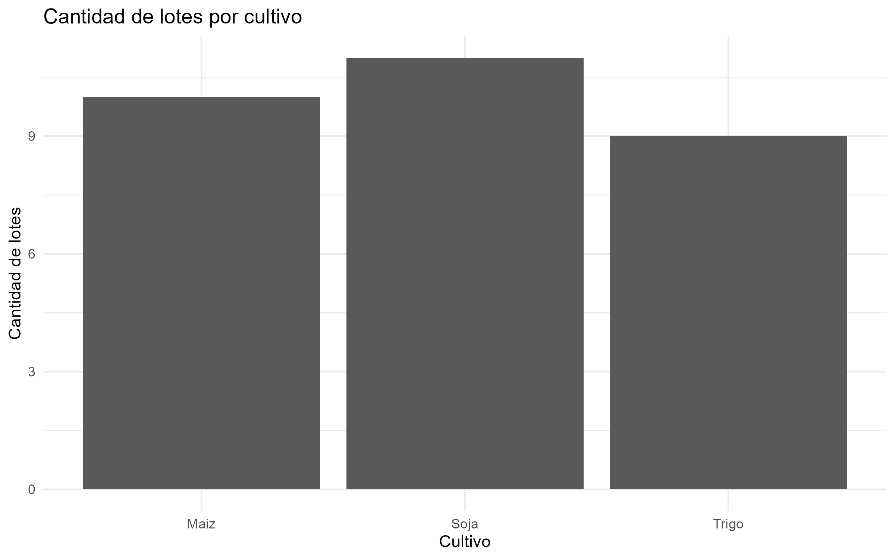
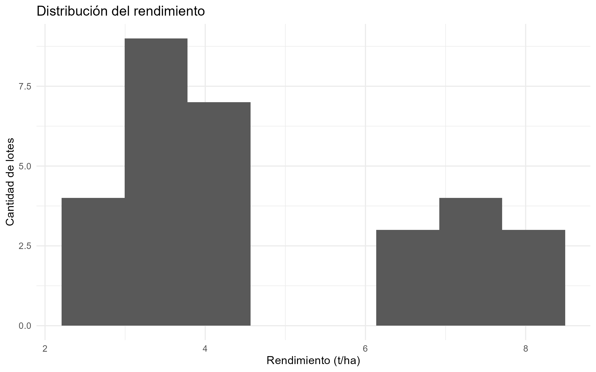
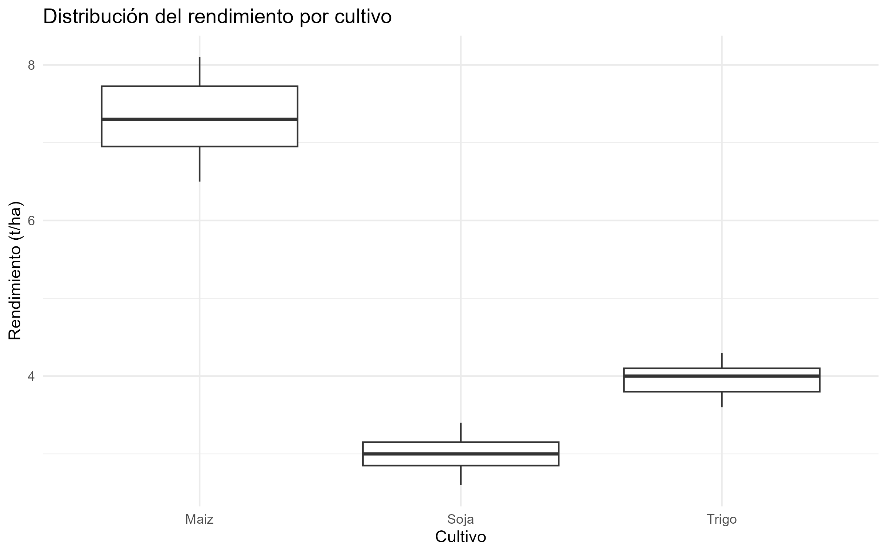
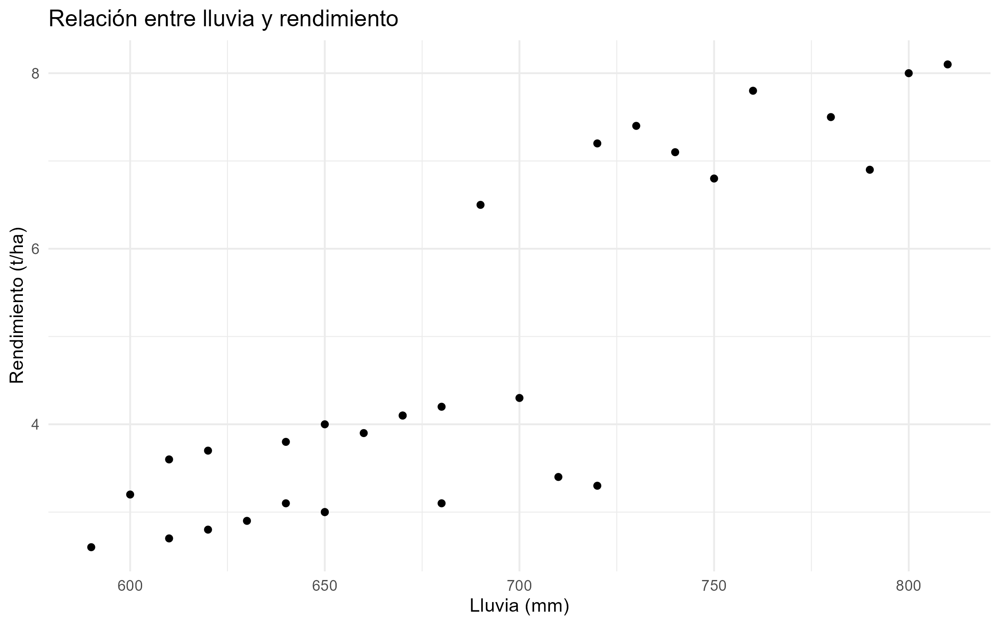
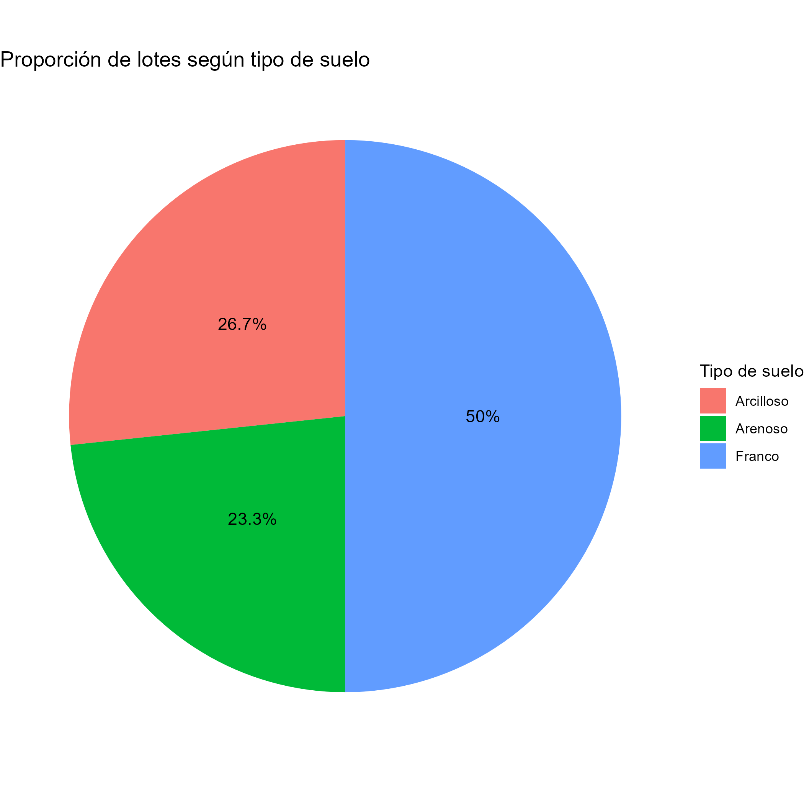
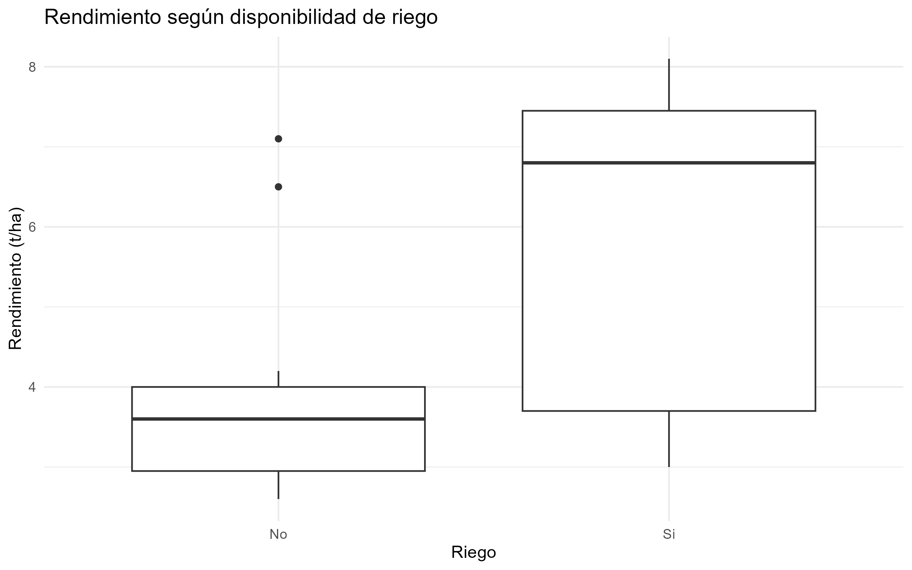

# Práctico de Análisis de Datos Agropecuarios con R

## 1. Introducción

Este trabajo presenta un análisis exploratorio de un conjunto de datos agrícolas utilizando **R** y la librería **ggplot2**.

El objetivo es aplicar herramientas de estadística descriptiva y visualización de datos para analizar variables relacionadas con la producción agrícola, como el rendimiento, cultivo, precipitaciones, tipo de suelo y disponibilidad de riego.

A partir del análisis se buscan identificar características de los datos, medidas de tendencia central y dispersión, así como posibles relaciones entre las variables productivas y ambientales.

---

## 2. Objetivos

Los principales objetivos del trabajo son:

* Cargar y explorar un conjunto de datos agrícolas mediante R.
* Identificar las variables disponibles y sus tipos.
* Calcular medidas de tendencia central.
* Analizar medidas de dispersión y posición.
* Generar visualizaciones para facilitar la interpretación de los datos.
* Analizar la distribución del rendimiento agrícola.
* Comparar el rendimiento de lotes con y sin riego.
* Explorar la relación entre precipitaciones y rendimiento.
* Analizar la distribución de los lotes según el tipo de suelo.

---

## 3. Herramientas utilizadas

* **R 4.6.1**
* **Visual Studio Code**
* **ggplot2**
* Archivo de datos: `datos_agricultura.csv`

---

## 4. Estructura del proyecto

```text
Practico_R/
│
├── datos_agricultura.csv
├── practico_agricultura.R
├── README.md
│
└── img/
    ├── barras_cultivo.png
    ├── histograma_rendimiento.png
    ├── boxplot_cultivo.png
    ├── dispersion_lluvia_rendimiento.png
    ├── torta_suelo.png
    └── boxplot_riego.png
```

---

# 5. Exploración inicial de los datos

El conjunto de datos contiene información relacionada con lotes agrícolas y diferentes variables productivas y ambientales.

Entre las variables utilizadas durante el análisis se encuentran:

* `rendimiento_t_ha`: rendimiento del lote expresado en toneladas por hectárea.
* `cultivo`: cultivo presente en el lote.
* `lluvia_mm`: precipitaciones registradas en milímetros.
* `tipo_suelo`: clasificación del suelo.
* `riego`: disponibilidad de riego en el lote.

El conjunto analizado contiene **30 lotes**.

Para realizar la exploración inicial se utilizaron funciones como:

```r
head(datos)
names(datos)
str(datos)
summary(datos)
```

Estas funciones permiten observar los registros, conocer las variables disponibles, identificar sus tipos de datos y obtener un resumen estadístico inicial.

---

# 6. Medidas de tendencia central

La variable seleccionada para analizar las medidas de tendencia central fue:

```text
rendimiento_t_ha
```

## 6.1 Media

El rendimiento promedio obtenido fue:

**4,736667 t/ha**

La media representa el rendimiento promedio considerando todos los lotes incluidos en el conjunto de datos.

## 6.2 Mediana

La mediana obtenida fue:

**3,95 t/ha**

La mediana divide los datos ordenados en dos partes iguales, dejando el 50 % de las observaciones por debajo y el 50 % por encima.

## 6.3 Comparación entre media y mediana

La media (**4,736667 t/ha**) es superior a la mediana (**3,95 t/ha**).

La diferencia indica que ambas medidas no son similares y que la distribución de los rendimientos presenta cierta asimetría hacia valores altos.

Es posible que algunos lotes con rendimientos elevados estén aumentando el valor de la media. En este contexto, la mediana resulta una medida complementaria importante porque es menos sensible a valores extremos.

---

# 7. Medidas de dispersión y posición

Para analizar la dispersión de los rendimientos se calcularon el mínimo, máximo, rango, cuartiles e intervalo intercuartílico.

| Medida       |  Resultado |
| ------------ | ---------: |
| Mínimo       |   2,6 t/ha |
| Q1           | 3,125 t/ha |
| Mediana (Q2) |  3,95 t/ha |
| Q3           | 6,875 t/ha |
| Máximo       |   8,1 t/ha |
| IQR          |  3,75 t/ha |

El rango total de los rendimientos es:

**8,1 - 2,6 = 5,5 t/ha**

El intervalo intercuartílico es:

**6,875 - 3,125 = 3,75 t/ha**

Por lo tanto, el **50 % central de los rendimientos se encuentra entre 3,125 y 6,875 t/ha**.

Esto permite observar una dispersión considerable dentro de los rendimientos registrados.

---

# 8. Visualización de los datos

## 8.1 Cantidad de lotes por cultivo

El siguiente gráfico permite observar cómo se distribuyen los lotes según el cultivo.



### Interpretación

El gráfico permite comparar visualmente la cantidad de lotes correspondientes a cada cultivo presente en el conjunto de datos.

Esta visualización facilita identificar qué cultivos tienen mayor o menor representación dentro de la muestra.

---

## 8.2 Distribución del rendimiento

Se utilizó un histograma para observar la distribución de la variable `rendimiento_t_ha`.



### Interpretación

El histograma permite observar cómo se distribuyen los rendimientos entre los diferentes intervalos de valores.

Los rendimientos presentan valores comprendidos entre **2,6 y 8,1 t/ha**.

La diferencia observada entre la media y la mediana también sugiere cierta asimetría en la distribución, con presencia de valores altos que influyen sobre el promedio.

---

## 8.3 Rendimiento por cultivo

Se utilizó un diagrama de caja para comparar la distribución del rendimiento entre los diferentes cultivos.



### Interpretación

El boxplot permite comparar la mediana, la dispersión y el rango de los rendimientos para cada cultivo.

Esta visualización resulta útil para detectar diferencias en la distribución del rendimiento entre cultivos y posibles valores extremos.

---

## 8.4 Relación entre lluvia y rendimiento

Se utilizó un gráfico de dispersión para analizar visualmente la relación entre las precipitaciones y el rendimiento.



### Interpretación

El gráfico permite observar la distribución conjunta de las variables `lluvia_mm` y `rendimiento_t_ha`.

La representación permite identificar visualmente si existe algún patrón o tendencia entre ambas variables.

Es importante destacar que la observación de una posible relación gráfica no implica necesariamente una relación causal. El rendimiento puede estar condicionado simultáneamente por otros factores productivos, ambientales y de manejo.

---

# 9. Distribución de los lotes según tipo de suelo

Para analizar la composición de los lotes según el tipo de suelo se calcularon las frecuencias y porcentajes correspondientes.

| Tipo de suelo | Cantidad | Porcentaje |
| ------------- | -------: | ---------: |
| Franco        |       15 |     50,0 % |
| Arcilloso     |        8 |     26,7 % |
| Arenoso       |        7 |     23,3 % |
| **Total**     |   **30** |  **100 %** |



### Interpretación

El tipo de suelo **Franco** representa el **50 %** de los lotes analizados, con 15 lotes.

Los suelos **Arcillosos** representan aproximadamente el **26,7 %**, mientras que los suelos **Arenosos** representan aproximadamente el **23,3 %**.

Por lo tanto, dentro del conjunto analizado existe una mayor presencia de lotes con suelo Franco.

---

# 10. Análisis del efecto del riego

Una de las preguntas de análisis planteadas fue:

> ¿Los lotes con riego presentan un rendimiento promedio superior a los lotes sin riego?

Para responder esta pregunta se calcularon los rendimientos promedio agrupados según la disponibilidad de riego.

| Riego | Rendimiento promedio |
| ----- | -------------------: |
| Sí    |            5,66 t/ha |
| No    |        3,813333 t/ha |

La diferencia entre ambos promedios es aproximadamente:

**1,85 t/ha**

Los lotes con riego presentan un rendimiento promedio mayor que los lotes sin riego dentro del conjunto de datos analizado.

---

## 10.1 Visualización del rendimiento según riego



### Interpretación

El boxplot permite comparar la distribución del rendimiento entre los lotes que cuentan con riego y aquellos que no cuentan con este recurso.

En los datos analizados, los lotes con riego presentan un rendimiento promedio de **5,66 t/ha**, mientras que los lotes sin riego presentan un promedio de **3,813333 t/ha**.

Esto representa una diferencia descriptiva de aproximadamente **1,85 t/ha a favor de los lotes con riego**.

Los resultados muestran una asociación entre la disponibilidad de riego y mayores niveles de rendimiento en esta muestra.

Sin embargo, esta diferencia descriptiva **no permite afirmar que el riego sea por sí solo la causa del mayor rendimiento**, ya que pueden intervenir otros factores como:

* Tipo de cultivo.
* Tipo de suelo.
* Cantidad de precipitaciones.
* Condiciones climáticas.
* Manejo del lote.
* Otras prácticas agrícolas.

Por este motivo, para determinar un efecto causal sería necesario realizar un análisis estadístico más profundo y controlar estas variables.

---

# 11. Principales resultados

A partir del análisis realizado se obtuvieron los siguientes resultados:

* El conjunto de datos contiene **30 lotes**.
* El rendimiento promedio fue de **4,736667 t/ha**.
* La mediana del rendimiento fue de **3,95 t/ha**.
* Los rendimientos variaron entre **2,6 y 8,1 t/ha**.
* El 50 % central de los rendimientos se encuentra entre **3,125 y 6,875 t/ha**.
* El intervalo intercuartílico fue de **3,75 t/ha**.
* El suelo Franco representa el **50 % de los lotes**.
* Los lotes con riego presentaron un rendimiento promedio de **5,66 t/ha**.
* Los lotes sin riego presentaron un rendimiento promedio de **3,813333 t/ha**.
* La diferencia descriptiva entre ambos grupos fue de aproximadamente **1,85 t/ha**.

---

# 12. Conclusiones

El análisis exploratorio permitió aplicar diferentes herramientas de estadística descriptiva y visualización sobre un conjunto de datos agrícolas.

El estudio del rendimiento mostró una diferencia entre la media y la mediana, acompañada de una dispersión considerable entre los valores mínimos y máximos.

Las visualizaciones permitieron analizar la distribución de los lotes por cultivo, la distribución de los rendimientos, las diferencias entre cultivos, la relación entre precipitaciones y rendimiento y la composición de los lotes según tipo de suelo.

Uno de los principales resultados fue la diferencia descriptiva observada entre los lotes con y sin riego. Los lotes con riego presentaron un rendimiento promedio superior dentro del conjunto de datos analizado.

No obstante, estos resultados deben interpretarse como **análisis descriptivos de la muestra** y no como evidencia de causalidad. Para obtener conclusiones más robustas sería necesario incorporar un mayor número de observaciones y aplicar técnicas estadísticas que permitan controlar simultáneamente diferentes factores productivos y ambientales.

---

# 13. Código utilizado

El análisis completo se encuentra en:

```text
practico_agricultura.R
```

El script contiene:

* Carga de datos.
* Exploración inicial.
* Cálculo de medidas estadísticas.
* Agrupación de datos.
* Generación de gráficos.
* Export
